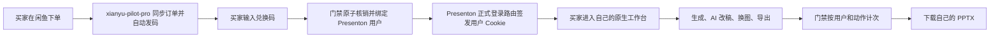
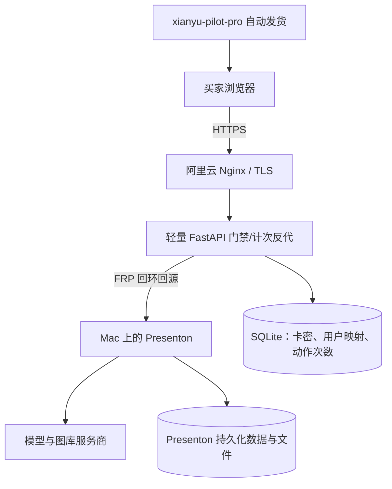

# 闲鱼 AI PPT 卡密服务方案 v2.1：保留 Presenton 原生工作台

> 状态：建议方案 / MVP 设计稿（v2.1）。截至 2026-10-27 已核对公开源码与 Release；本文不代表已部署、已验证成本或已完成平台/法律合规核验。用户创建、路由、Cookie、隔离和计费均需在锁定镜像上回归。

## 1. 方案结论

产品目标仍是：闲鱼买家购买服务后收到兑换码，在网页中使用 Presenton 原生工作台生成、在线改稿并导出可编辑 PPTX。

**不采用“一个共享 Presenton + 24 小时 Cookie 门禁”的做法。** 新方案为每张有效卡建立专属 Presenton 普通用户和私有工作区；轻量门禁服务负责核销卡密、调用 Presenton 登录路由，以及按经验证的 AI 操作做次数限制。首版不需要重写现有 Java 计费系统，也不直接写 Presenton 数据库。

现行 Presenton 开源源码包含管理员创建用户 `POST /api/v1/admin/users` 和用户登录 `POST /api/v1/auth/login` 路由，可用于验证“兑换码映射影子用户”的轻量方案。管理员路由依赖管理员认证；登录路由由 Presenton 自己签发会话 Cookie。应通过这些路由而不是直写 SQLite 或手工签发 JWT。由于公开 README 未承诺这些 API 的长期兼容性，必须锁定版本并在升级时回归。Enterprise 文档另有 SSO/OIDC/SCIM。[Presenton 用户路由](https://github.com/presenton/presenton/blob/main/servers/fastapi/api/v1/admin/router.py) · [Presenton 认证路由](https://github.com/presenton/presenton/blob/main/servers/fastapi/api/v1/auth/router.py) · [Presenton README](https://github.com/presenton/presenton/blob/main/README.md)

## 2. 产品原则

- 买家使用自己的 Presenton 用户和私有工作区，作品、模板、任务和文件不能被其他用户看到。
- 兑换码决定套餐权益；Presenton 登录决定用户身份。两者必须在服务端可靠关联。
- 试点阶段可先销售有限的生成/AI 编辑动作次数；不售卖无限调用的“24 小时畅用卡”。编辑、改写、换图、重生成都要纳入计次策略，跑出成本数据后再决定是否改成页数套餐。
- 前端不持有模型 API Key、Presenton 管理员凭据或其他用户的 Presenton API Key。
- Presenton 只对外开放 HTTPS；FRP 只提供受控的服务器内网回源，不开放可绕过门禁的公网端口。
- `ghcr.io/presenton/presenton:latest` 仅用于试验；正式环境锁定经过验收的版本/镜像摘要。

### 本次联网核验与版本判断（2026-10-27）

Presenton 官方已发布 `v0.9.12-beta`，标记提交为 `93b9dcf`，Release 页面列出 PR #980、#984、#988、#995 等变更。该版本仍是 Beta，不能仅凭 Release 记录认定生产稳定；应固定 Docker tag 与实际拉取的镜像 digest，检查镜像是否对应该提交，并完成阶段 0 回归后才考虑小规模试运营。[v0.9.12-beta Release](https://github.com/presenton/presenton/releases/tag/v0.9.12-beta)

PR #980 的主要安全修复针对 Electron 桌面本地服务认证和文件访问边界，不能把桌面端漏洞直接等同于 Docker 自托管漏洞；但也不能据此跳过 Docker 形态的访问控制、文件隔离和代理测试。[PR #980](https://github.com/presenton/presenton/pull/980) PR #984 将旧 `CAN_CHANGE_KEYS` 配置替换为管理员角色权限；#988 修复已有任务数据时 `/status/{id}` 可能失败；#995 完善模板布局的 AI 幻灯片编辑。具体以目标镜像实际包含的变更为准。

MVP 默认选 `PRESENTATION_GENERATION_MODE=standard`，Smart 模式后续另测；`PRESENTON_COMMUNITY_ENABLED=false` 可关闭社区功能，但这些工作流/功能开关不是访问控制。登录、AI 调用、文件访问与导出仍必须由身份认证和门禁策略保护。[Presenton README 配置](https://github.com/presenton/presenton/blob/main/README.md)

## 3. 目标业务流程

### 用户路径

1. 闲鱼买家购买指定套餐，现有自动发货系统发送一次性兑换码和 Presenton 入口。
2. 买家输入兑换码；门禁原子核销并查找或创建对应的 Presenton 普通用户。
3. 门禁调用 Presenton 正式登录路由，由 Presenton 签发用户 Cookie；买家无需再填写第二套账号密码。
4. 买家在 Presenton 内生成和编辑 PPT；门禁按已认证的 Presenton 用户 ID 对生成、AI 编辑和图像生成等操作限次。
5. 下载和再次编辑都由 Presenton 用户工作区保护；门户提供额度、任务和售后查询。

## 4. 推荐部署拓扑

### 域名与网络

- 配置独立域名 `ppt.linjitech.com`，由阿里云 Nginx 终止 HTTPS；不要用明文 HTTP 公网 IP 承载卡密或登录 Cookie。
- Mac 上 Presenton 仅监听 `127.0.0.1`，FRP 客户端从 Mac 主动连接阿里云。
- FRP 服务端把业务代理绑定到 `127.0.0.1`（确认所用 frps 版本的 `proxyBindAddr` 配置），只允许 Nginx/网关从本机回源；云防火墙不得开放 Presenton 回源端口。
- 公网开放 443，以及 FRP 客户端确实需要的控制连接端口（常见为 7000）；控制端口启用认证/TLS，并通过云防火墙限制来源 IP（动态 IP 时采取等效访问控制）。FRP 业务回源端口只绑定云主机 `127.0.0.1`，绝不开放公网；禁用未使用的管理端口。
- Presenton `PRESENTON_PUBLIC_URL` 设置为对外 HTTPS 域名，避免生成链接指向容器名、私网地址或 HTTP。
- Mac 禁止自动睡眠，配置断线自恢复、磁盘空间告警、备份和远程健康检查。家庭宽带、停电、重启仍是可用性风险；试运营需要明确维护窗口和故障通知。

FRP 官方配置说明其 TCP `remotePort` 在 frps 代理监听地址上提供入口，代理地址默认会跟随服务端监听地址；因此不能假设它自然只监听云服务器的 `127.0.0.1`。[FRP 服务端配置](https://github.com/fatedier/frp/blob/dev/conf/frps_full_example.toml)

## 5. 身份、兑换与 Presenton 用户关联

### 兑换码

- 兑换码使用至少 128 位随机熵；数据库仅保存带服务端 pepper 的哈希，原码仅在生成/导出时展示一次。
- 码有套餐、状态、有效期、关联闲鱼商品/订单、核销用户、核销时间；支持冻结、补发、退款处理和操作审计。
- 核销必须是单事务、条件更新、唯一约束保护；同码并发兑换只能成功一次，幂等重放返回原结果。
- `/admin/gen` 不使用 GET 查询密码，不设置硬编码口令；运营端需管理员认证、速率限制和批次导出记录。

### Presenton 影子用户与免二次登录

Presenton 用户是数据隔离主体，不能让所有卡密用户共用一个登录。每张卡在门禁数据库中映射到一个 Presenton user ID；用户名使用随机内部 ID，不能使用卡密或卡密后缀。

1. 首次只在本地/内网初始化 Presenton 主管理员；管理员凭据仅保存在门禁服务端的 Secret 中。
2. 首次兑换使用可恢复的跨系统状态机：门禁先事务写入 `pending` 和唯一业务 ID，再调用 `POST /api/v1/admin/users` 创建普通用户，保存 Presenton user ID 后置为 `provisioned`；登录验证成功后才转为 `active`。失败时按稳定的内部用户名查询/恢复，不盲目重复创建；管理员用户创建与本地 SQLite 不是一个原子事务。
3. 门禁调用 `POST /api/v1/auth/login`，让 Presenton 自己签发该用户的会话 Cookie。反代正确传递 HTTPS 上下文，并确保 Cookie 是本站 HTTPS 域名下的 HttpOnly、Secure Cookie。
4. 后续同一码登录映射到同一用户和工作区；过期时由门禁逐请求检查权益。禁止把卡密原文放进 Cookie、用户名或日志。
5. 退款/封禁后的会话撤销、数据保留和删除按套餐规则处理；不要因兑换码到期自动删除买家作品。

门禁服务器收到 Presenton 登录响应的 `Set-Cookie`，不代表浏览器已登录；必须将经过审查的用户会话 Cookie 安全转交浏览器，再调用 `/api/v1/auth/verify` 或等效身份接口确认用户 ID。不得把 Presenton 用户密码或管理员 Cookie 返回给买家。后续每个代理请求都检查权益状态；过期或冻结应立即拦截新的 AI 操作。必要时可通过管理员密码重置使旧会话失效（目标版本需实测 auth version 行为）；避免用删除账户来撤销会话，因为删除可能连同用户文件一起移除。作品查看/下载权与生成权益分开设计，并明确在售后规则中说明。

当前源码有上述路由，但目标镜像是否兼容、请求模型和 Cookie 行为需要按锁定版本实测。**不得直写 SQLite、伪造 JWT 或自行构造 Presenton session cookie。**若当前版本的 API 不符合预期，应暂停公开售卖并重新评估，不要依赖未公开数据库结构。

## 6. 额度与模型成本控制

### 推荐套餐原则

首个封闭试点建议采用保守测试包：7 天有效、完整生成 2 次、AI 改稿 5 次、每份最多 10 页；额度到期后可保留只读查看/下载窗口，具体期限在售前明示。该配置是验证假设，不是已验证售价或成本承诺。后续根据 10/20 页账单、失败率与售后数据调整，不提供无限调用或“24 小时不限量”。

### 用量拆分

一次初始生成之外，Presenton 编辑工作台还可能触发 AI 改稿、对话式修改、重新生成内容和图片等操作。因此账本至少记录：

- `initial_generation`：初始生成的页数和模型调用成本。
- `ai_edit`：对话式编辑、文本改写及结构调整。
- `image_generation`：单独记录图像供应商调用和费用。
- `export`：只在确有额外成本时计费，普通 PPTX 导出可不扣 AI 页数。

规模化后再从以下方式择一，不可把不同单位混为一个“页数”：

1. **页数额度 + 编辑次数/成本额度**：更接近原套餐，但前提是能获取可靠的用户级、操作级用量。
2. **生成页数额度 + 限量编辑包**：例如每份 PPT 包含固定次数的 AI 修改，超出后另行购买。
3. **时长通行证 + 强制总量上限**：只适合试运营；必须有每人每日调用上限、并发限制和全局成本熔断，不能等同无限畅用。

### 用量网关

Presenton 当前配置中的模型密钥是实例级配置。轻量试点可在反代层按 Presenton user ID 对经验证的 AI 操作做次数限制，不必一开始搭 Token 计量网关。不过路径计数只限制操作次数，不等于货币成本封顶：一次生成/编辑可能触发多次模型请求，实际成本会随页数、输入体积、上下文和图像操作变化。

反代通过 Presenton 会话解析用户 ID，对每个计费动作原子预留；使用 `reserved → settled / released` 状态和 Presenton task ID/请求幂等键防止重试重复扣次。超时不等于失败：先查询任务状态，无法确定时保留预留并进入人工/异步对账，不能自动返还后让任务继续消耗。生成失败是否释放额度按错误类型和任务是否实际调用模型判定。完整覆盖 UI、REST API、用户 API Key、异步任务和 `/mcp` 等可能的模型花费入口；初期默认关闭 MCP 与未审核 API，只允许路由清单中的方法/路径/操作。未知 AI 或写入路径默认拒绝，不能无条件透传。通过 UI 验证纯手工改字、拖拽和导出确实不触发模型后，才设为免费操作。

操作次数不是实际成本上限：一次完整生成可以触发多次 LLM、图片检索和重试。首期同时设置最大页数、输入/上传体积、每用户并发、单任务成本上限、供应商日/月预算与全局熔断；逐任务记录模型供应商 usage/费用（若供应商可提供）。在没有模型出口统一计量或可验证的供应商账单之前，不宣称单卡亏损上限。账务记录至少包含业务操作 ID、Presenton task ID、用户 ID、预留额度、最终状态、可得的 token/图像费用和退款/补偿审计。

### 硬限制

- 限定最大单份页数、上传文件体积/格式、每用户并发和每日任务数。
- 供应商级设置日/月预算、速率限制和停机熔断；达到预算立即暂停昂贵操作并通知运营。这是次数限制之外的全局成本保护。
- 对换图和“再生成”设置更严格的默认限额；图片生成作为单独高成本档位。
- 用户页数额度/编辑次数/有效期的最终规则必须在商品详情、兑换页面和服务条款一致说明。

## 7. 安全要求

- 所有登录和卡密交互使用 HTTPS；Cookie 设置 `HttpOnly`、`Secure`、合理 `SameSite` 和过期策略，启用 CSRF 防护。
- 签名密钥、Presenton 管理员凭据、模型 Key、FRP Token 放入受保护的 Secret 文件或密钥管理服务；不写进代码、访问 URL、前端或日志。
- `CAN_CHANGE_KEYS=false` 不作为安全控制：Presenton 当前主分支 README 标明该旧变量已忽略。按当前版本的管理员/普通用户角色机制配置，并在发布镜像上实测。[Presenton 当前配置说明](https://github.com/presenton/presenton/blob/main/README.md)
- Presenton 初始化前不开放公网；管理员凭据强随机，并在首次启动后完成验证和轮换。
- Presenton 管理员 Cookie 仅供门禁服务端调用用户创建等管理 API；买家不能访问 `/api/v1/admin/*`，也不能看到或复用管理员会话。
- 兑换、登录、注册、上传和生成均做速率限制；上传先限制大小、类型和总存储，代理流式转发，不将整个大文件读取到门禁进程内存。
- 反代正确处理 WebSocket/SSE（如所选版本使用）、压缩响应、`Set-Cookie`、重定向、长任务超时和下载流，并关闭上游流；不要直接使用未审计的通用透传路由。
- 做双普通用户交叉访问测试，覆盖作品列表、上传源文件、静态资源、任务状态、异步结果、预览图、导出下载和被篡改的 user/task/file ID；仅验证首页或作品列表不足以证明隔离完整。
- 每位用户独立目录/权限；下载 URL 限时并绑定任务所有者；日志屏蔽卡密、Cookie、Prompt 原文和 API Key。
- Pexels/Pixabay 可降低 AI 生图成本，但不能描述成“无版权”。核对 API 来源展示和调用限额，以及图片中的商标、人物和其他权利；Pexels API 要求显著链接回 Pexels，默认有调用限额。[Pexels API 规则](https://www.pexels.com/api/documentation/) · [Pexels 许可](https://www.pexels.com/license/) · [Pixabay 许可摘要](https://pixabay.com/service/license-summary/)
- 做生成文件和用户上传的保留/删除策略、数据库与文件备份，并演练恢复。

## 8. 现有项目如何复用

| 现有模块 | 复用方式 | 不应直接复用的地方 |
|---|---|---|
| 闲鱼账号、订单同步、自动发货 | 订单检测后发送一次性兑换码 | 不让自动发货卡密表承担 PPT 额度账本和用户授权 |
| 用户注册/登录 | 作为门户用户身份的候选基础 | 不假设现有登录态能自动登录 Presenton；需先验证跨应用身份整合 |
| AI 计费账本 | 借鉴账本、预扣、结算和审计结构 | 现有 Token 单位不是 PPT 页数，避免直接复用余额字段造成混账 |
| Docker/监控/发布流程 | 作为门户和计量服务的部署基线 | Mac 上的 Presenton/文件需要额外持久化、备份和健康监控 |

代码入口：[卡密库存 API](../apps/core-api/src/main/java/com/xianyu/admin/controller/CardController.java)、[自动发货执行器](../apps/core-api/src/main/java/com/xianyu/admin/service/DeliveryExecutionService.java)、[AI 计费 API](../apps/core-api/src/main/java/com/xianyu/admin/controller/AiBillingController.java)。

## 9. 部署前检查（2026-10-27）

### 阿里云门禁/FRP 节点

已只读检查用户提供的阿里云主机，尚未对远程主机做任何文件、服务、防火墙或容器修改：

- Ubuntu 24.04.2；系统识别内存约 1.6 GiB、可用约 771 MiB、无 swap。该主机正在运行既有学生优惠网站及 Nginx，不适合未经容量验证就承载 Presenton 本体。
- Nginx 正监听 80/443，`ai.linjitech.com` 已有 HTTPS 证书；现有站点反代到 `127.0.0.1:3006`。不得覆盖其默认站点或直接改写现有代理规则。
- Docker 已运行 `geometrylab-student-offers` 的 API 和 Web 服务；本次不触碰现有容器、目录、Postgres、Redis 或代理服务。
- 当前没有检测到 FRP 服务端/客户端；`ppt.linjitech.com` 在主机 DNS 查询中尚未解析，现有证书也只覆盖 `ai.linjitech.com`。
- 因此，云端可作为门禁/FRP 控制节点的方向仍可行，但还缺新子域名 DNS 与 TLS、Mac 上 FRP 客户端接入和模型/图库提供方配置。完成这些条件前不切换现有 Nginx 流量，也不宣称端到端部署完成。

### 本地 Mac Presenton

- 本地已有 Presenton 容器，镜像标记为 `ghcr.io/presenton/presenton:latest`，挂载 `/Users/hulk/presenton_data` 到 `/app_data`，端口映射为 `127.0.0.1:5001`；作品数据目录已有，改造时必须保留。
- 容器目前处于重启循环（退出码 3），错误日志显示启动缺少 `IMAGE_PROVIDER` 配置。它已有自定义 LLM 配置，但本次未读取任何密钥值。用户已选择 Unsplash；Presenton 当前上游没有原生 `unsplash` provider，不能只设置 `IMAGE_PROVIDER=unsplash`。需要自定义扩展 Presenton 图像服务，并在应用展示照片时标注 Unsplash 与摄影师、链接摄影师主页，按 API 指南 hotlink 图片；用户把照片插入 PPT 并导出时，还要触发对应下载事件接口。需先验证导出 PPTX 的嵌入图片流程如何满足 API 条款，再接入该 API。[Presenton 图像配置](https://github.com/presenton/presenton/blob/main/README.md) · [Unsplash API 指南](https://help.unsplash.com/en/articles/2511245-unsplash-api-guidelines) · [Unsplash API 条款](https://unsplash.com/api-terms)
- 本次没有读取、复制或保存 Unsplash 凭证。开始接入前应在 Unsplash Developer 控制台轮换已暴露凭证；图片搜索等公开 API 请求只需 Access Key 的 Client-ID 认证，不应把 Secret Key 放入 Presenton 或浏览器。Unsplash API demo mode 默认每小时 50 次请求；应按预计流量申请生产额度，并确认应用满足署名、hotlink 与下载事件要求。[Unsplash API 文档](https://unsplash.com/documentation) · [申请更高调用额度](https://help.unsplash.com/en/articles/3887917-when-should-i-apply-for-a-higher-rate-limit)
- 本地镜像 digest 为 `sha256:d4015defa8abae0bcb235b4952448616f9189a12451bb96b1f75474979e813d7`，未带可读版本/提交标签；不能据此认定它是 `v0.9.12-beta`。需先确定升级/固定版本策略，备份数据后再调整容器。

这次检查未读取或复制任何现有 `.env`、数据库凭据或证书私钥。

## 10. 轻量 MVP 阶段与验收

### 阶段 0：可行性验证（先做，不上线售卖）

- 固定 Presenton 版本，在隔离环境配置管理员、自定义模型和选定的图像提供方。
- 用管理员 API 创建两个普通用户，再用正式登录路由登录；验证门禁可按兑换码映射到相应 Presenton 会话。
- 验证两个用户之间的作品、模板、历史任务、上传资料、编辑器、导出链接完全隔离。
- 用浏览器 Network 面板记录当前版本初始生成、AI 改稿、聊天编辑、重新生成、图像生成、纯手工保存和导出的真实方法与路径；不要照搬旧版本的猜测路径。
- 当前官方 README 公布的自托管生成 API 是 `POST /api/v1/ppt/presentation/generate`；示例中的 `/api/v1/ppt/generate` 不是该文档所列路径。浏览器 UI 可能经过不同路由，必须以目标版本真实请求为准。[Presenton 自托管生成 API](https://github.com/presenton/presenton/blob/main/README.md)
- 验证计次网关能稳定获取 Presenton user ID，覆盖成功、失败、并发、重试和直接 API 调用。
- 通过公网域名验证 HTTPS、FRP 回环绑定和 7080 端口无法从外网访问；模拟 Mac/隧道断线与恢复。
- 按目标镜像扫描全部路由和方法，验证 UI、REST、MCP、API Key 与异步任务无法绕过权益；冻结/过期后，用现存浏览器 Cookie 发起 AI 操作必须被拒绝，历史作品访问按约定仍可用。
- 并发提交同一兑换码只创建一个 Presenton 用户；同一生成请求重放不重复预扣；模拟供应商超时、Mac 重启和回调延迟，账本不得重复结算或错误释放。
- 记录模型供应商控制台中的各类动作成本，配置页数/请求体限制、每日预算和熔断。不要把套餐动作次数直接折算成固定人民币成本。

**阶段 0 通过条件**：目标镜像中管理员创建用户和用户登录路由可用；买家输入一次兑换码即可进入自己的工作区；所有已识别的 AI 花费操作均计次；公网无绕过门禁的入口；全局费用熔断生效；用户资料和下载相互隔离。

阶段 0 验收还必须覆盖兑换并发、免二次登录的真实浏览器 Cookie 流程、REST/MCP/API Key 绕过、已有会话冻结、异步任务预留/结算恢复，以及两个普通用户对所有文件与任务资源的交叉访问。产物包括路由清单、锁定镜像 digest、成本记录和故障恢复记录。逐项验收清单：

- [ ] 固定目标 Docker 镜像 tag 和 digest；核对登录、用户创建、导出及安全修复。
- [ ] 同一兑换码并发核销时只创建一个 Presenton 普通用户，失败流程可幂等恢复。
- [ ] 买家输入兑换码后浏览器无需再次输入 Presenton 账号密码；Cookie 与 `/auth/verify` 身份一致。
- [ ] 用户 A 不能读取用户 B 的作品、上传文件、静态资源、任务、异步结果和导出文件。
- [ ] 直接调用未开放 REST 路由、MCP、API Key 和未审核路径不能绕过权益检查。
- [ ] 篡改用户 ID、任务 ID、文件 ID 或 Cookie 不能跨用户访问。
- [ ] 额度耗尽、过期或冻结后，已有会话不能启动新的付费 AI 操作；历史作品访问按产品规则处理。
- [ ] 并发、超时、重试、Mac/门禁重启和异步任务恢复不重复扣次、不提前释放预留。
- [ ] 供应商预算封顶或全局熔断触发后，新的付费任务会被拒绝。
- [ ] 公网无法直接访问 Presenton 或 FRP 业务回源端口；FRP 控制端口有来源限制。
- [ ] 断网、Mac 重启、数据库与文件恢复后，订单、用户归属和作品仍一致。
- [ ] 完成 10/20 页成本、导出质量/成功率测试，并核验闲鱼类目、备案及内容标识义务。

若用户映射、Cookie 续期或计费路由覆盖不可靠，暂停公开售卖；继续小批量人工账户验证，或改为自有门户调用 Presenton API。不要通过写数据库或伪造 JWT 绕过阶段门槛。

### 阶段 1：小规模 MVP

- 实现兑换码批次、网站兑换、闲鱼订单对账、Presenton 用户映射和权益状态。
- 实现兑换码/Presenton 用户映射、按用户动作计次、全局预算熔断、超额拒绝、异常补偿和管理员审计；先不重写 Java 计费系统，验证规模与成本后再决定是否并入 Core API。
- 建立用户与文件删除流程、服务条款/隐私说明和基本运维告警。
- 内部邀请少量测试用户，不开放公开自助注册或无限试用。

### 阶段 2：闲鱼试运营

- 先发少量体验卡，验证订单—兑换—登录—生成—编辑—下载—退款全链路。
- 观察 10/20 页代表性任务的真实文本与图片成本、P50/P95 时长、失败率、Mac 可用性和投诉情况。
- 根据数据调整价格、套餐和编辑额度，不以示例成本作为真实单位成本。

### 阶段 3：正式开放

- 完成生产环境密钥、HTTPS、备份恢复、告警、容量和断线演练。
- 通过现有仓库正式发布门禁；当前 CI `release-provenance-gate` 仍会阻断 tag 发布，需先配置镜像签名/来源证明。
- 核验闲鱼实际开放类目、认证和自动履约方式；完成 AI 生成内容标识、隐私与服务条款评估。
- 核验具体商品类目是否允许出售自有在线 AI PPT 服务、兑换网站履约及自动发码；闲鱼现行协议允许符合条件的部分经营性主体提供商品/服务，但不能据此认定具体类目已获准。[闲鱼社区用户服务协议（2026-06-15 生效）](https://terms.alicdn.com/legal-agreement/terms/suit_bu1_other/suit_bu1_other201708081618_51146.html) 若使用中国内地云服务器对公众提供网站，按阿里云备案要求完成 ICP 备案，并根据实际有偿服务形态另行判断许可要求。[阿里云 ICP 备案要求](https://help.aliyun.com/zh/icp-filing/basic-icp-service/product-overview/icp-filing-requirements-for-a-regular-website) 评估生成式 AI 服务适用义务、个人信息处理，以及 2025-09-01 起施行的生成合成内容标识要求；这需要对 PPTX、图像和对外传播场景分别核验，不能仅依赖开源许可证。[GB 45438-2025](https://openstd.samr.gov.cn/bzgk/std/newGbInfo?hcno=F32EA2A561F1886CD8D606513512D547) · [生成合成内容标识办法](https://www.cac.gov.cn/2025-03/14/c_1743654684782215.htm) · [生成式人工智能服务管理暂行办法](https://www.cac.gov.cn/2023-07/13/c_1690898327029107.htm)
- 采用限量上线和预算熔断，达到运营指标后再扩量。

## 11. 决策清单

1. 首轮套餐暂按“2 次生成 + 5 次 AI 编辑、单份最多 10 页、有效 7 天”做封闭测试；成本数据是否支持调整？资料大小上限是多少？
2. 兑换码有效期和 Presenton 会话时长是否相同？到期后是否允许查看/下载已有作品？
3. 目标镜像中的用户创建、用户登录、Cookie 续期和计费路由是否通过阶段 0 验收？
4. 首发文本模型、图库/图像模型和检索服务分别选什么，实测动作成本是多少？
5. Mac/家庭宽带中断时如何停售、通知和补偿？
6. 闲鱼类目、经营资质、站外兑换和自动发货方式由谁核验？AI 内容标识和隐私条款由谁确认？

## 12. 当前结论

可以用轻量 FastAPI + SQLite 门禁、Presenton 官方管理员/登录路由、每码一个普通用户工作区和动作次数限额做小规模 MVP，不必先改造整套 Java 系统。仍需锁定 Presenton 版本并验证实际 UI 路由、身份隔离、Cookie 代理和调用成本；不能承诺“1 天完成”或“单卡成本必低于 0.15 元”。完成阶段 0 前，不公开售卖，也不承诺无限用量。
