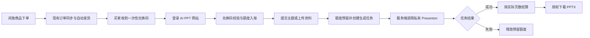
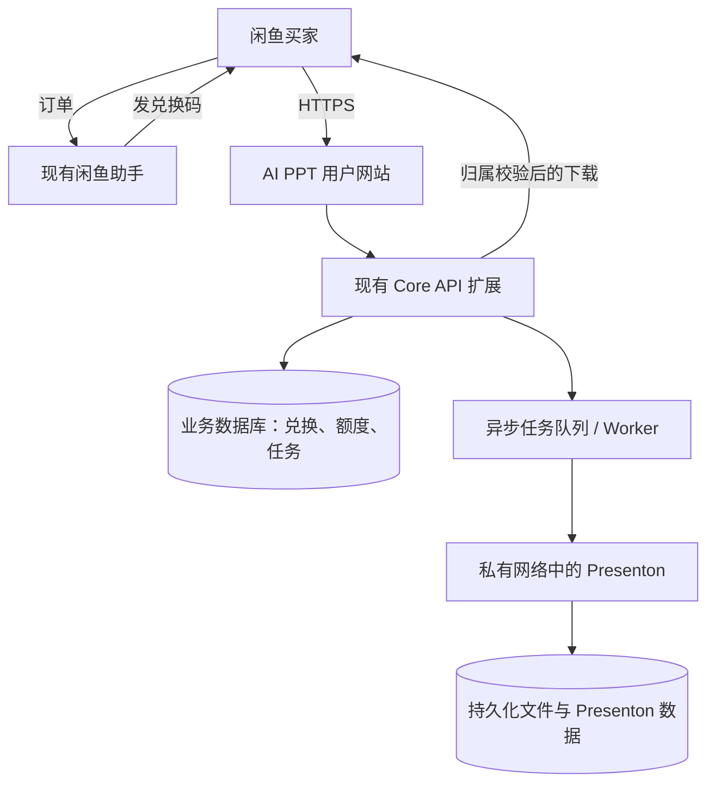

# 闲鱼 AI PPT 卡密服务整体方案

> 已被 [方案 v2：保留 Presenton 原生工作台](ai-ppt-card-service-plan-v2.md) 取代。本文作为早期草案留档；实施时以 v2 为准。

> 状态：早期方案设计稿，内容未按 Presenton 原生登录、用户隔离和用量计量要求更新。

## 1. 目标与边界

通过闲鱼销售 AI PPT 生成额度：买家下单后自动收到一次性兑换码，在自有网站注册或登录、兑换额度、提交主题或资料，生成并下载可编辑 PPTX。

首版建议采用 Presenton 自托管作为 PPT 生成引擎，在现有闲鱼助手上扩展兑换、额度账本和任务管理。闲鱼助手负责订单与自动发货，业务网站负责用户、兑换、计费和文件交付，Presenton 负责演示文稿生成与导出。

首版不做完整 PPT 编辑器、不提供无限生成、不向买家发放模型密钥或 Presenton API Key，也不把 Presenton 管理后台直接开放为面向买家的主站。

## 2. 产品流程

### 用户侧体验

1. 买家在闲鱼购买明确标注页数额度、适用范围和兑换规则的商品。
2. 现有自动发货流程发送唯一兑换码及网站入口和使用说明。
3. 买家在网站登录后兑换，账户显示可用页数和兑换记录。
4. 买家提交主题、受众、语言、页数、风格和可选资料文件。
5. 网站显示异步生成状态；成功后提供 PPTX 下载，失败则不扣最终额度。

## 3. 现有项目能力与差距

| 领域 | 当前仓库能力 | 本方案如何使用 / 需要补充 |
|---|---|---|
| 闲鱼订单与自动发货 | 有账号连接、订单同步、发货规则和卡密库存发货 | 复用为兑换码交付渠道；需要配置专用商品与发货规则，并验证订单幂等和补发行为 |
| 卡密仓库 | `CardController` 管理库存卡密；自动发货服务原子认领并发送 | 作为运营侧导入待发兑换码的库存工具，不作为用户兑换鉴权数据库 |
| 用户体系 | 有注册、登录、用户资料和租户上下文 | 复用登录与用户身份；增加 PPT 业务入口和权限校验 |
| AI 计费 | 有余额、计费记录、账本和内部预扣/扣费接口 | 可借鉴账务模式；建议新建独立“页数额度”账本，避免将 PPT 页数与现有 Token 单位混用 |
| PPT 生成 | 未发现 Presenton 适配器、任务、结果文件或下载授权流程 | 新增 Presenton 集成、异步任务、私有文件交付及故障恢复 |
| 兑换码 | 未发现网站侧一次性兑换并授予额度的端到端接口 | 新增兑换码批次、校验、原子核销、入账、审计和防重放 |

代码参考：[CardController.java](../apps/core-api/src/main/java/com/xianyu/admin/controller/CardController.java)、[DeliveryExecutionService.java](../apps/core-api/src/main/java/com/xianyu/admin/service/DeliveryExecutionService.java)、[AiBillingController.java](../apps/core-api/src/main/java/com/xianyu/admin/controller/AiBillingController.java)、[UserAuthController.java](../apps/core-api/src/main/java/com/xianyu/admin/controller/UserAuthController.java)。

## 4. 建议的系统结构

### 部署与信任边界

- Presenton 作为独立容器或独立服务部署在内网，不直接暴露公网端口。
- 浏览器只调用本项目 API。Presenton 的 API Key、模型供应商密钥和内部地址只保存在服务端。
- PPT 生成采用异步任务。请求、轮询、失败重试、超时和文件清理均由本项目控制。
- 下载前校验当前登录用户与任务/文件所有权；使用短期签名下载地址或由后端代理下载，避免公开永久文件 URL。
- Presenton 需要独立持久化数据和文件，并纳入备份、容量监控、版本升级和恢复演练；具体依赖按所选版本的官方部署文档确认。
- MVP 优先复用现有 Core API 和 worker 运行能力；若生成任务显著增加资源争用，再拆出专用 PPT API/worker 服务。

Presenton 官方仓库说明其支持自托管、多用户、用户级 API Key 和可编辑 PPTX，并采用 Apache-2.0 许可。自托管 API 与 Cloud API 的接口版本不同，实施时以锁定版本的自托管文档为准，不能直接照搬 Cloud API 示例。[Presenton 仓库](https://github.com/presenton/presenton) · [自托管 API Docker 示例](https://presenton-521d9e2f.mintlify.app/v3/tutorial/generate-presentation-over-api-using-docker) · [Presenton API 文档](https://docs.presenton.ai/v3/guide/using-presenton-api)

## 5. 核心业务模块

### 5.1 兑换码与额度账本

建议新增独立的数据模型，不复用 `card_item` 作为消费凭证：

- **兑换码批次**：套餐、额度、创建人、创建时间、渠道/商品标识、批次状态。
- **兑换码**：仅存高强度随机码的哈希、批次 ID、状态、有效期、核销用户、核销时间和来源订单标识。原始码只在创建/导出时展示一次。
- **额度账户**：用户可用页数、预留页数和累计统计；所有变更必须由账本记录驱动。
- **额度账本**：兑换入账、任务预留、成功结算、失败释放、人工补偿/退款，记录前后余额、业务 ID、幂等键和操作者。

兑换操作必须在事务中校验并原子地将码标记为已使用、建立兑换记录和授予额度。重复提交同一兑换请求应返回原兑换结果，不重复入账。禁止根据客户端提交的 user ID 或页数决定入账对象和额度。

### 5.2 生成任务与扣费

- 创建任务时检查用户状态、账户额度、单次页数上限、文件大小/类型、并发与频率限制。
- 先预留额度，再向 Presenton 创建任务；请求需带本项目生成的幂等标识。
- 成功后按最终导出的实际幻灯片页数结算；失败、超时或取消按明确策略释放预留额度。
- 对不确定的超时结果先查询 Presenton 任务状态，避免盲目重试产生重复生成或重复扣费。
- 任务状态至少包括 `queued`、`running`、`succeeded`、`failed`、`cancelled`；记录外部任务 ID、请求参数摘要、页数、耗时、成本估算、错误类别和结果文件引用。
- 管理员可查询任务与账本，执行补偿必须留下操作者、原因和审计记录。

### 5.3 文件与隐私

- 上传资料设置类型、体积、数量和保留期限；禁止把用户文件内容写入普通应用日志。
- 结果文件按用户/任务隔离保存；下载校验用户授权，设置过期时间和清理策略。
- 页面和服务条款说明文本、资料文件会发送给哪些模型/图像/搜索供应商及其保留边界。
- 备份覆盖数据库、用户上传资料、生成结果、Presenton 持久化数据和必要配置，并定期演练恢复。

## 6. 商品套餐与计费原则

以下价格来自试运营构想，仅为待验证假设，不是市场价格或成本承诺。

| 套餐 | 试算售价 | 额度 | 说明 |
|---|---:|---:|---|
| 体验卡 | ¥3.90 | 8 页 | 适合首次体验 |
| 标准卡 | ¥9.90 | 30 页 | 主推套餐 |
| 进阶卡 | ¥19.90 | 80 页 | 高频用户 |

建议以“成功导出的实际页数”为扣费单位，失败任务不扣最终额度。需在开发前确定标题页/目录页是否计入、每单最大页数、是否允许拆分多份 PPT、额度有效期、退款后的额度处理、上传资料是否额外收费。建议先用低成本文本模型和可复用模板验证生成质量，再逐步启用图片生成。

按套餐计算的单笔贡献可用以下公式估算：

`售价 -（实际生成页数 × 每页模型/图片成本）- 支付/平台费用 - 存储与带宽 - 售后及退款成本`

上线定价前要用代表性中文提示词实测 10 页、20 页等典型任务的模型调用、重试、图片生成和服务器成本；不能把示例中的每页成本假设当成真实报价。

## 7. 闲鱼履约设计

1. 为每个套餐配置独立商品 ID 与库存组，库存内容是一次性兑换码及网站兑换说明。
2. 订单进入已付款状态后，沿用现有发货规则自动发送一个码；失败时由现有发货重试和人工补发流程处理。
3. 给每个兑换码批次保存商品/订单来源映射，核对已售订单、已发码、已核销、未核销和退款数量。
4. 退款、错发、买家重复咨询或码泄露时，运营端可以冻结未核销码、补发新码或人工补额度，并写审计记录。
5. 首发阶段优先采用平台允许的类目和发货方式，不使用自动化接口规避平台限制。

## 8. 安全、合规与运营

- **账户与密钥**：只在服务端保存模型和 Presenton 凭据；独立的最小权限密钥，定期轮换；限制管理端访问并记录操作审计。
- **防滥用**：兑换频率限制、登录防爆破、每用户并发/日用量/单任务页数上限、文件上传限制和任务超时。
- **内容与文件标识**：面向公众提供生成服务前，评估适用的生成式 AI 服务要求。中国《人工智能生成合成内容标识办法》自 2025 年 9 月 1 日施行，涉及生成内容显式标识及文件元数据等要求；需要针对 PPTX、网站展示和用户导出流程落实，并由合规/法律顾问结合实际业务确认。[官方办法](https://www.cac.gov.cn/2025-03/14/c_1743654684782215.htm)；[生成式人工智能服务管理暂行办法](https://www.cac.gov.cn/2023-07/13/c_1690898327029107.htm)。
- **闲鱼类目**：闲鱼当前用户协议只在开放的特色服务类别等场景支持经营性商品/服务，并可能要求必要认证。发布前应在 App 和官方规则中核实 AI PPT 服务、站外兑换履约和自动发货方式是否被允许。[闲鱼社区用户服务协议](https://terms.alicdn.com/legal-agreement/terms/suit_bu1_other/suit_bu1_other201708081618_51146.html)
- **服务治理**：明确服务条款、隐私政策、退款/额度补偿办法、数据删除机制、模型供应商清单、投诉渠道和内容使用规则。
- **可观测性**：至少监控任务成功率/耗时/失败原因、队列积压、每页成本、额度异常、文件存储增长和自动发货失败率；告警应能通知到实际值守人员。

## 9. MVP 阶段与验收条件

### 阶段 A：验证引擎和单位成本

- 锁定 Presenton 版本，使用自托管 API 验证中文主题、上传资料、10/20 页生成和 PPTX 可编辑性。
- 验证异步状态查询、失败类型、超时行为、任务隔离、文件清理和备份恢复。
- 输出真实每页模型/图像成本、平均和 P95 生成时长、成功率。

**验收**：成功结果可编辑且用户间隔离；失败不会产生不可追踪扣费；模型密钥没有进入浏览器包或日志。

### 阶段 B：网站兑换与计费闭环

- 增加兑换码批次、兑换页面、额度账户/账本、PPT 生成任务 API 和下载授权。
- 建立任务预留/成功结算/失败释放的幂等处理。
- 加入套餐限制、管理查询、审计和异常补偿流程。

**验收**：同一码并发兑换只入账一次；重复请求不会重复创建任务或重复扣费；跨用户访问任务和结果被拒绝。

### 阶段 C：闲鱼小批量试运营

- 配置商品与自动发货模板，少量真实订单验证下单、发码、兑换、生成、下载、售后和退款对账。
- 根据真实成本修正价格和套餐；观察至少一个完整售后周期。

**验收**：每笔订单可追踪至码、用户、额度账本、生成任务和下载；发货/兑换/生成异常有可执行人工补偿步骤。

### 阶段 D：正式上线

- 生产密钥、监控、备份恢复、容量限制、域名 HTTPS 和故障演练全部完成。
- 当前仓库正式发布门禁也必须先解除：CI 的 `release-provenance-gate` 目前会因未配置镜像签名与来源证明而阻止 tag 发布；需先完成对应发布供应链配置并验证目标提交。
- 先限量开放，再按成功率、成本、投诉率和退款率决定扩量。

## 10. 上线前待决策清单

1. 用户是必须注册登录，还是允许先兑换后绑定账户？建议首版要求登录，减少额度丢失与售后争议。
2. 额度是否过期、有效期多长？退款后如何处理已兑换/已消耗额度？
3. 页面额度是否按最终导出的幻灯片数计算？目录页、封面页和失败重试如何计数？
4. 每个套餐的单份 PPT 最大页数、每日生成上限、并发数和资料上传限制是多少？
5. Presenton 的用户/工作区如何与本项目用户对应，生成文件保存多久？
6. 首发模型和图片来源有哪些，供应商条款是否允许面向终端用户提供付费生成服务？
7. 闲鱼对应商品类目、经营认证、站外兑换说明和自动发货方式是否获平台允许？
8. 中国大陆服务所需备案/生成式 AI 相关手续、内容标识及隐私文本由谁确认？
9. 首轮试运营数量、预算上限、值守人和退款/补偿权限如何设置？

## 11. 当前结论

现有项目能复用闲鱼订单与自动发货基础，也有用户体系和 AI 账务可参考；但网站兑换码、按页额度账本、PPT 异步生成和下载授权仍需开发。当前生产发布门禁尚未通过，因此建议顺序为：先验证 Presenton 和成本，再做兑换/额度 MVP，然后小批量试运营，最后满足发布、合规和运维门槛后正式开放。
